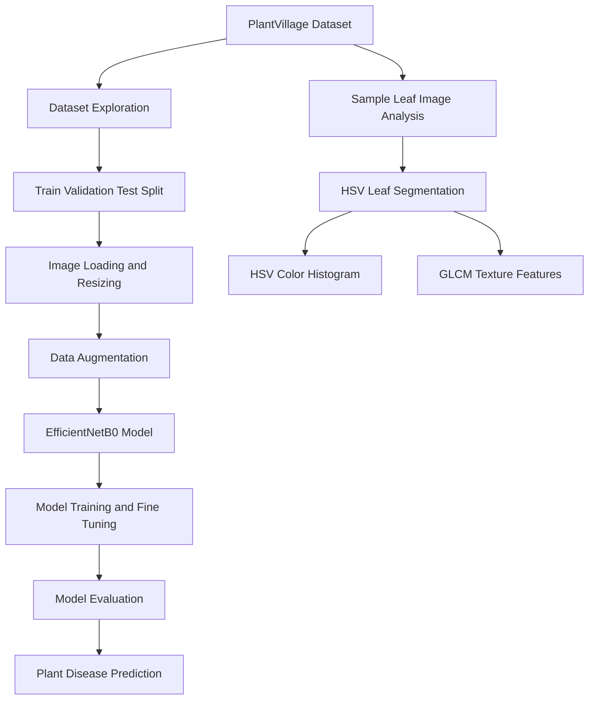
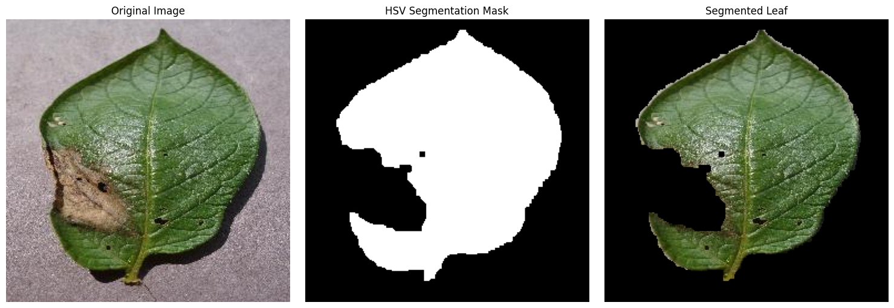
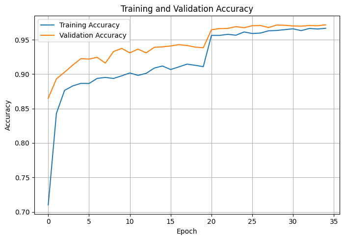
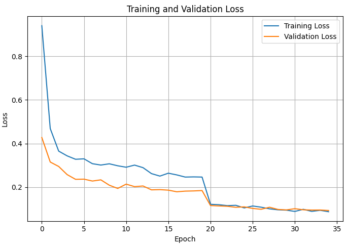
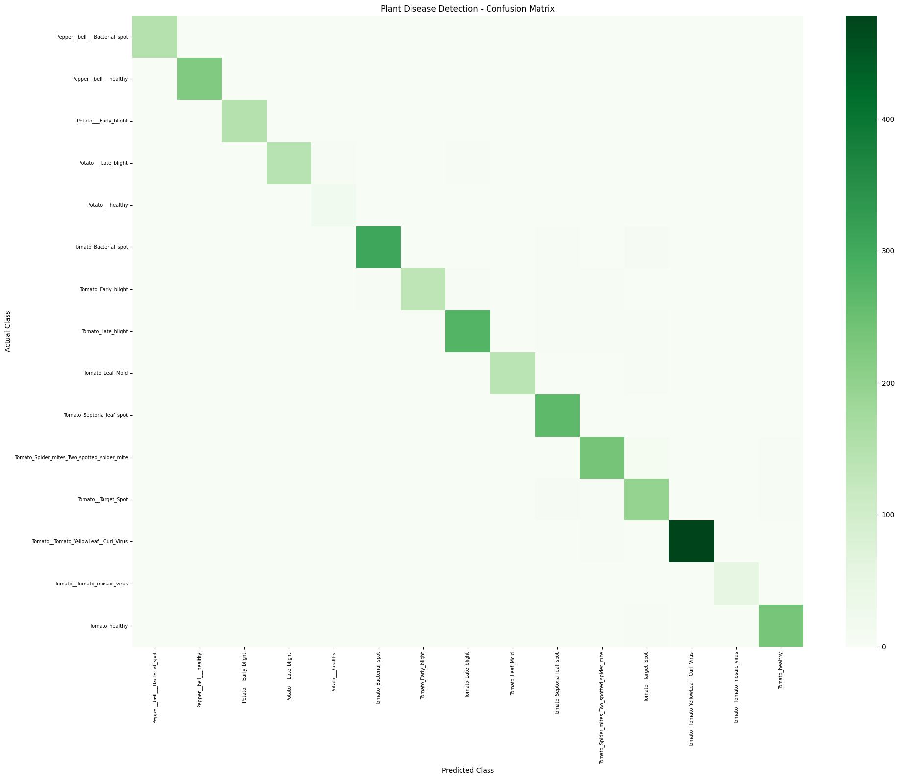
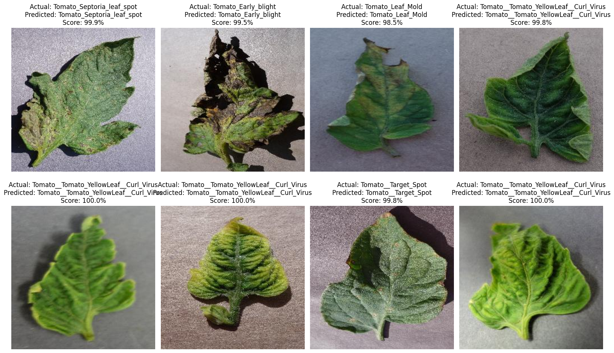

# 🌿 Smart Agriculture – Plant Disease Detection Using Leaf Image Processing

<div align="center">


### 🌱 Empowering Agriculture Through Image Processing & Artificial Intelligence

**An intelligent plant disease classification system that analyzes leaf images to identify plant diseases and support smarter agricultural practices.**

<br/>


<br/>


</div>

---

## 🌾 About the Project

Agriculture plays a vital role in our everyday lives. However, plant diseases can significantly affect crop quality, productivity, and agricultural income.

**Smart Agriculture – Plant Disease Detection Using Leaf Image Processing** is an image-based classification project designed to identify plant diseases by analyzing leaf images.

The project combines traditional image processing techniques with deep learning-based image classification to recognize different plant disease categories.

Using the PlantVillage dataset, the system processes leaf images, performs segmentation and feature extraction, and predicts the corresponding plant health or disease category.

### 🎯 Project Objectives

- 🌿 Identify plant diseases from leaf images.
- 🎨 Apply HSV-based color segmentation for leaf extraction.
- 🔬 Extract color and texture features from leaf images.
- 🧠 Develop an image classification model using EfficientNetB0.
- 📊 Evaluate model performance using standard classification metrics.
- 🌱 Explore how computer vision can contribute to smart agriculture.

---

## ✨ Key Features

| Feature | Description |
|---|---|
| 🌿 Leaf Image Analysis | Processes plant leaf images |
| 🎨 Color Segmentation | Uses HSV color space to segment leaves |
| 🔬 Feature Extraction | Extracts HSV color histogram and GLCM texture features |
| 🧠 Disease Classification | Uses an EfficientNetB0-based model |
| 📊 Model Evaluation | Calculates accuracy, precision, recall, and F1-score |
| 🔥 Confusion Matrix | Visualizes classification performance |
| 🖼️ New Image Prediction | Predicts the disease category of an uploaded leaf image |
| 💾 Model Saving | Saves the trained model in Keras format |

---

## 🛠️ Technologies & Tools

### Programming Language
- Python

### Libraries & Frameworks

- **OpenCV** – Image processing and segmentation.
- **NumPy** – Numerical operations.
- **Pandas** – Dataset organization and manipulation.
- **Matplotlib** – Data visualization.
- **Seaborn** – Statistical visualization.
- **Scikit-image** – GLCM texture feature extraction.
- **Scikit-learn** – Dataset splitting and evaluation metrics.
- **TensorFlow / Keras** – Deep learning and model training.

### Development Environment

- Google Colab
- Kaggle API
- GitHub

---

## 📂 Dataset Information

The project uses the **PlantVillage Dataset**, a publicly available collection of plant leaf images.

🔗 **Dataset:** [PlantVillage – Kaggle](https://www.kaggle.com/datasets/arjuntejaswi/plant-village)

### 📊 Dataset Statistics

| Category | Details |
|---|---:|
| Total Images | 20,638 |
| Total Classes | 15 |
| Training Images | 14,446 |
| Validation Images | 3,096 |
| Testing Images | 3,096 |
| Image Input Size | 224 × 224 |

### 🌱 Plant Categories

The dataset covers three plant types:

- 🍅 Tomato
- 🥔 Potato
- 🫑 Pepper (Bell Pepper)

It includes healthy leaf categories and different disease categories, such as:

- Early Blight
- Late Blight
- Bacterial Spot
- Leaf Mold
- Septoria Leaf Spot
- Target Spot
- Spider Mites
- Yellow Leaf Curl Virus
- Tomato Mosaic Virus

---

## ⚙️ Project Workflow

The project follows a structured image-processing and classification pipeline.


### 🔍 Step-by-Step Explanation

**1. Dataset Collection**

Collected plant leaf images from the PlantVillage dataset using the Kaggle API.

**2. Dataset Exploration and Splitting**

Examined image counts and class distribution, then divided the dataset into training, validation, and testing sets.

**3. HSV-Based Leaf Segmentation**

Applied HSV color-space segmentation with morphological operations to identify green leaf regions and generate segmentation masks.

**4. Color Feature Extraction**

Extracted HSV color histograms from sample leaf images to analyze their color characteristics.

**5. Texture Feature Extraction**

Used Gray Level Co-occurrence Matrix (GLCM) to calculate texture properties:

- Contrast
- Homogeneity
- Energy
- Correlation

**6. Image Preprocessing**

Resized RGB images to 224 × 224 pixels and prepared TensorFlow datasets for model training.

**7. Model Development**

Implemented an EfficientNetB0-based transfer-learning model with data augmentation and additional classification layers.

**8. Model Evaluation**

Evaluated the trained model using accuracy, precision, recall, F1-score, and a confusion matrix.

**9. Disease Prediction**

Uploaded a new leaf image and generated its predicted disease category with a confidence score.

**Note:** HSV segmentation and color-texture feature extraction are separate image-processing analyses. The EfficientNetB0 classifier uses resized RGB images as its input.
---

## 🧠 Model Architecture

The project uses **EfficientNetB0**, a convolutional neural network architecture, with transfer learning.

The classification architecture includes:

- Input Layer (224 × 224 × 3)
- Data Augmentation
- EfficientNetB0 Feature Extractor
- Global Average Pooling
- Batch Normalization
- Dropout
- Dense Classification Layer (15 Classes)

The model was trained in two stages, followed by fine-tuning to improve classification performance.

---

### 💾 Trained Model Files

The trained model and class-name mapping are saved in the `models/` directory.

- **plant_disease_model.keras:** Contains the trained EfficientNetB0-based plant disease classification model.
- **class_names.json:** Stores the class labels used to interpret the model's prediction outputs.

These files allow users to load the saved model and perform predictions without training the model again.

---

## 📈 Model Performance

The final model was evaluated using the test dataset.

<div align="center">

| Evaluation Metric | Score |
|:---:|:---:|
| 🏆 **Accuracy** | **97.32%** |
| 🎯 **Precision (Macro)** | **96.79%** |
| 📌 **Recall (Macro)** | **97.13%** |
| ⭐ **F1-Score (Macro)** | **96.91%** |

</div>

### 📊 Performance Visualization

The project includes:

- Training and validation accuracy graphs.
- Training and validation loss graphs.
- Confusion matrix.
- Classification report.
- Individual leaf image prediction results.

These visualizations help analyze the model's learning process and classification performance.

---

## 🖼️ Project Demonstration

This section presents the visual outputs generated during the project, including leaf segmentation, model training performance, confusion matrix, and disease prediction.

### 🌿 1. Leaf Image Segmentation

The following image demonstrates the leaf segmentation process using HSV color space and morphological operations.



### 📈 2. Model Training Performance

The following graphs show the training and validation accuracy and loss during model training.

**Training and Validation Accuracy**



**Training and Validation Loss**



### 📊 3. Confusion Matrix

The confusion matrix illustrates the classification performance of the model across all 15 plant disease classes.



### 🧠 4. Sample Disease Prediction

The following is an example prediction generated by the model.



**Example Prediction:**

```text
Predicted Class: Pepper__bell___Bacterial_spot
Model Confidence Score: 100.00%
```

*Note: This is an example result from the project execution, not a guarantee of accuracy for every new image.*
---

## 💻 How to Run the Project

The project is implemented using Google Colab.

### Step 1: Open the Notebook

Open the project notebook in Google Colab.

### Step 2: Install Dependencies

Run the installation commands provided in the notebook.

### Step 3: Configure Kaggle API

Upload your `kaggle.json` API token to Google Colab.

**Important:** Never upload your Kaggle API token or other private credentials to GitHub.

### Step 4: Download the Dataset

The notebook downloads the PlantVillage dataset using the Kaggle API.

### Step 5: Execute the Notebook

Run the notebook cells in sequence to perform:

- Dataset exploration
- Image preprocessing
- Leaf segmentation
- Feature extraction
- Model training
- Model evaluation
- Disease prediction

### Step 6: Upload a Leaf Image

Upload a new plant leaf image to test the trained classification model.

---

## 📁 Repository Structure

```text
Smart-Agriculture-Plant-Disease-Detection/
│
├── 📓 Plant_Disease_Detection.ipynb
│
├── 📄 README.md
│
├── 📄 requirements.txt
│
├── 📄 .gitignore
│
└── 📂 models/                 
|   ├── class_names.json
|   └── plant_disease_model.keras
|
└── 📂 results/                 
    ├── accuracy.png
    ├── confusion_matrix.png
    ├── loss.png
    ├── prediction_results.png
    └── segmentation.png
```
---

## 🌍 Real-World Applications

This project demonstrates how image processing and machine learning can be applied in agriculture.

Potential applications include:

- 🌱 Early identification of plant disease symptoms.
- 🚜 Supporting farmers in crop monitoring.
- 🌾 Assisting agricultural researchers.
- 📱 Development of smart farming applications.
- 🌍 Promoting technology-driven agricultural practices.

**Note:** This is an academic project and its predictions should not replace professional agricultural diagnosis.

---

## 🚀 Future Improvements

Some possible enhancements include:

- 📱 Developing a mobile application for farmers.
- 🌐 Creating a web-based disease detection platform.
- 📷 Supporting real-time camera-based leaf analysis.
- 🌿 Expanding the dataset to cover more plant species.
- 🔬 Improving performance on real-world images with complex backgrounds.
- 💡 Providing disease management and treatment recommendations.

---

## 🎓 Project Information

| Details | Information |
|---|---|
| Project Title | Smart Agriculture – Plant Disease Detection Using Leaf Image Processing |
| Project Number | Project 4 |
| Project Type | Individual Academic Project |
| Domain | Image Processing & Computer Vision |
| Programming Language | Python |
| Platform | Google Colab |
| Dataset | PlantVillage |

---

## 👩‍💻 Author

<div align="center">

### 🌸 Riya Dey

**BCA (Hons.) – Computational Sciences**

Interested in Python Programming, Image Processing, Computer Vision, and Artificial Intelligence.

</div>

---

## 💚 Final Thoughts

Technology and agriculture can work together to create a smarter and more sustainable future.

This project represents an exploration of how image processing and artificial intelligence can help identify plant diseases through leaf image analysis.

**🌱 Healthy Plants. 🌾 Smarter Farming. 🌍 Better Future.**

---

<div align="center">

### 🌿 THANK YOU FOR VISITING! 🌿

**If you find this project interesting, don't forget to give it a ⭐ Star!**

Made with 💚 and Python 🐍

</div>
